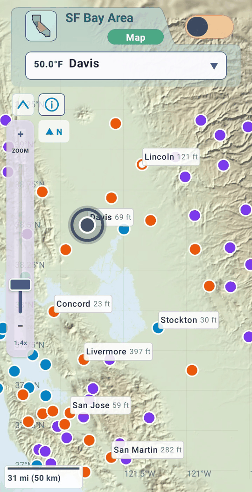
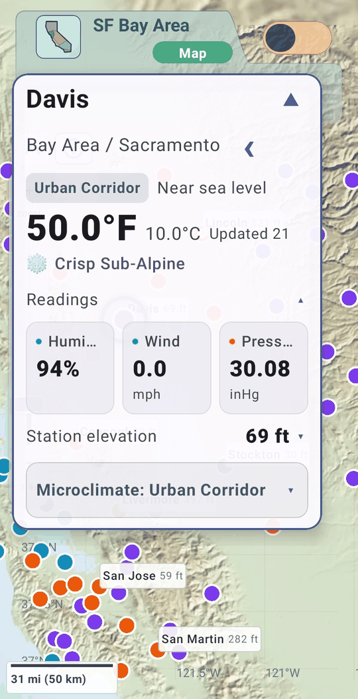
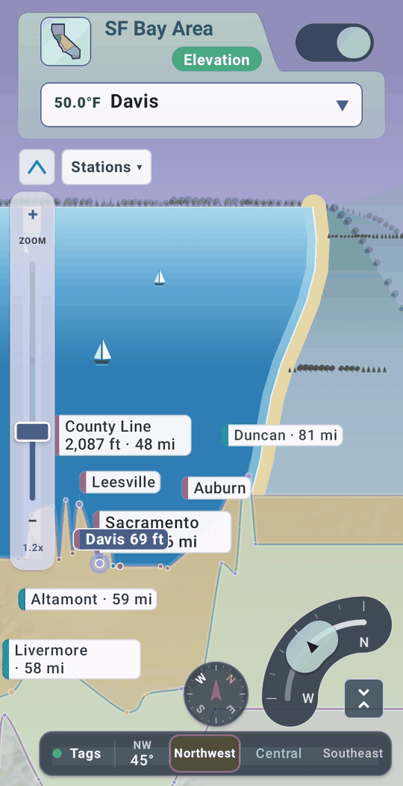
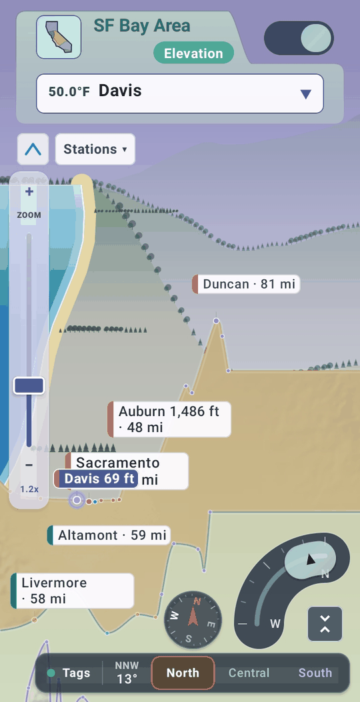
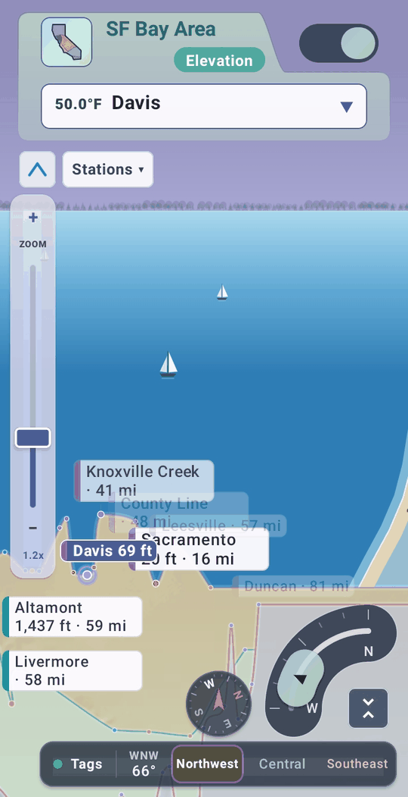
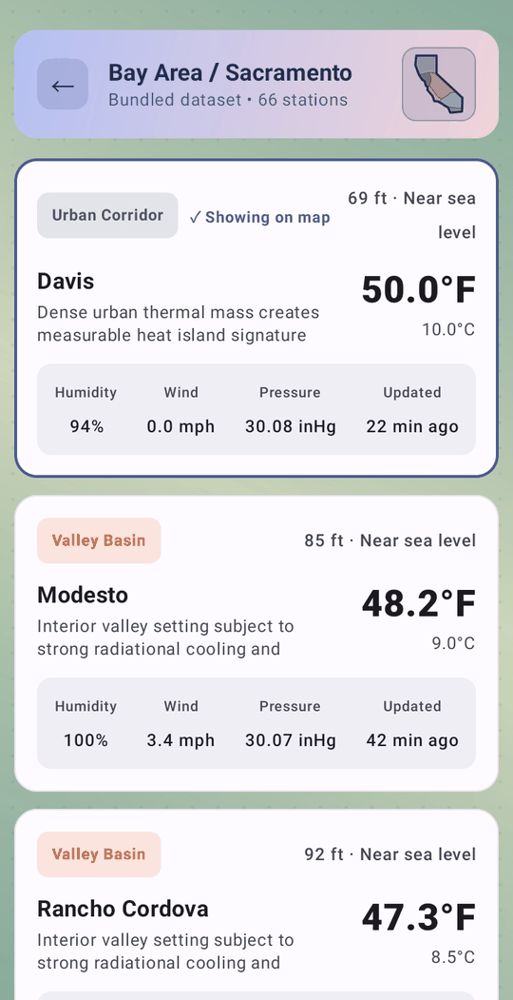
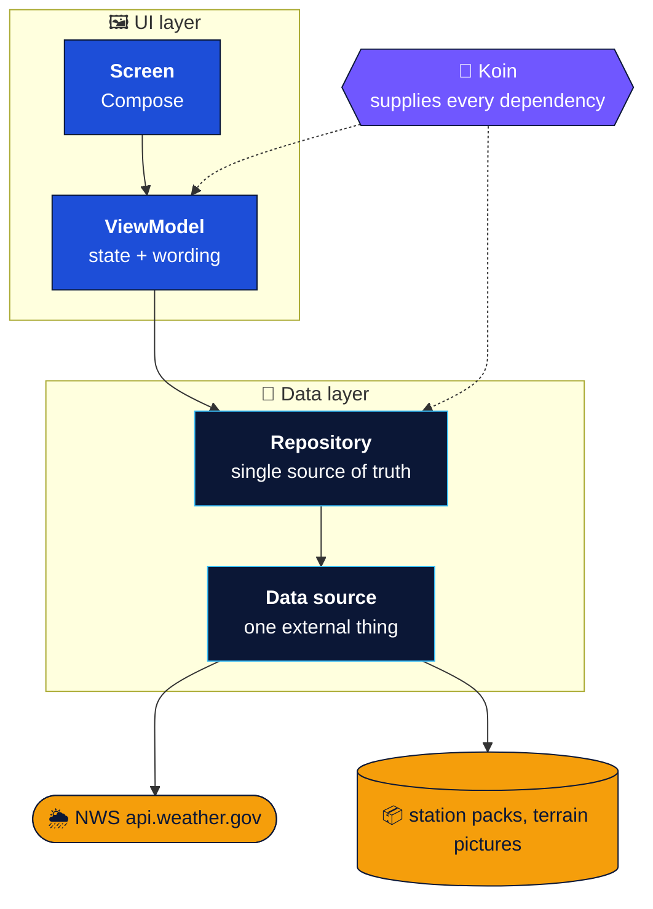
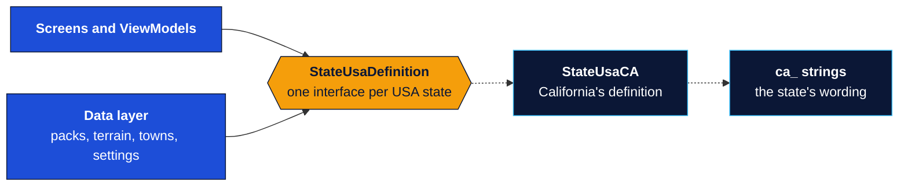

<div align="center">


<p>
<a href="#chip-nws"></a>
<a href="#chip-terrain"></a>
<a href="#chip-distance"></a>
<br>
<a href="#chip-bands"></a>
<a href="#chip-transitions"></a>
<a href="#chip-state"></a>
</p>

<br>

**An Android app that shows how California's weather changes from the coast to the mountains to the desert.**

<br>

<a id="screens"></a>

## 📱 Screens

<div align="center">

<table>
  <tr>
    <td align="center"></td>
    <td align="center"></td>
    <td align="center"></td>
  </tr>
  <tr>
    <td align="center"></td>
    <td align="center"></td>
    <td align="center"></td>
  </tr>
</table>

</div>

<br>

<a id="badge-kotlin"></a>
<a id="badge-compose"></a>
<a id="badge-architecture"></a>
<a id="badge-koin"></a>
<a id="badge-android"></a>
<a id="badge-license"></a>

[**Screens**](#screens) &nbsp;·&nbsp; [**What it does**](#what-it-does) &nbsp;·&nbsp; [**Run it**](#run-it) &nbsp;·&nbsp; [**Tech stack**](#tech-stack) &nbsp;·&nbsp; [**Design choices**](#design-choices) &nbsp;·&nbsp; [**Architecture**](#architecture) &nbsp;·&nbsp; [**Docs**](#docs)


</div>

<a id="what-it-does"></a>

## ✨ What Cali Climates does

California is many climates at once: fog on the coast, snow in the Sierra, desert heat an hour's drive inland. Cali Climates
shows that as it is right now. Pick one of six regions and see its weather stations on a relief map, with a real reading from
each, and how the numbers change as the ground climbs.

<table>
  <tr>
    <td width="33%" valign="top">
      <h4>🌡️ Live readings</h4>
      Temperature, humidity, wind and pressure from 338 National Weather Service stations, fetched on demand and kept for a few minutes so the app stays quick and polite.
    </td>
    <td width="33%" valign="top">
      <h4>🗺️ Six regions</h4>
      From Northern California to San Diego, each with its own earth tone. Change region and the page color, the map and the relief behind it all move together.
    </td>
    <td width="33%" valign="top">
      <h4>⛰️ Map view</h4>
      Stations on a shaded-relief picture of the region, with pinch, drag and double-tap zoom, and labels that appear as you zoom in.
    </td>
  </tr>
  <tr>
    <td valign="top">
      <h4>📈 Elevation view</h4>
      The same stations as a profile from valley floor to ridge, with layered distant ranges drawn from the real skyline, so you can see why the temperature changes. Switch on <b>Elevation Bands</b> and the stations separate into three layers, north at the back, with distance from the selected station on every label. A quarter dial turns the view from north toward west, and the scenery pans as you turn: the sea and a few sailboats slide in at the horizon beside a wandering shore.
    </td>
    <td valign="top">
      <h4>🪪 Station cards and lists</h4>
      A card per station with its terrain, height in feet, a plain-words band ("foothills", "high country") and a comparison with a well-known landmark.
    </td>
    <td valign="top">
      <h4>📳 A tactile region change</h4>
      A soft haptic tick, the page easing to the new region's color and the relief sliding to another part of the landscape: switching feels physical, not like a screen swap.
    </td>
  </tr>
</table>

<a id="run-it"></a>

## 🚀 Run it

Cali Climates is a standard Gradle project, so you can work on it in the editor you like best. It runs on Android 7.0 (API 24) and
newer, and the readings need an internet connection.

```bash
git clone https://github.com/GeneSJC/CaliClimates_Kotlin.git
cd CaliClimates_Kotlin
```

### Android Studio

One install brings the Android SDK, an emulator manager, Compose previews, and the layout and profiling tools. Use the current stable release.

1. Open the folder in Android Studio and let Gradle sync.
2. In the **Build Variants** panel keep the default, `coreFossDebug` (the app on its own, the open-source build).
3. Run it on a device or an emulator.

### Visual Studio Code

A light, fast editor with a built-in terminal; the Kotlin and Gradle extensions add syntax coloring, code navigation and Gradle tasks.

1. Install a JDK (17 or newer) and the Android SDK (the command-line tools are enough), then point Gradle at the SDK: set `ANDROID_HOME`, or put `sdk.dir=/path/to/Android/sdk` in a `local.properties` file in the project folder.
2. Open the folder in VS Code and add the **Kotlin** and **Gradle for Java** extensions.
3. Connect a phone or start an emulator (`adb devices` lists what is connected), then in the terminal:

```bash
./gradlew installCoreFossDebug
adb shell am start -n io.github.genesjc.climatefinder/.MainActivity
```

Any other editor works the same way: build with `./gradlew` and install with `adb`.

<details>
<summary><b>Command line and tests</b></summary>

```bash
# a debug APK of the default variant
./gradlew assembleCoreFossDebug

# unit tests (name both distributions: the bare task name is ambiguous with two flavor dimensions)
./gradlew testCoreFossDebugUnitTest testCoreCommercialDebugUnitTest
```

About 350 unit tests in 44 classes cover the ViewModels, the repositories, the live-readings holder, the NWS client (against a
local test server) and the station-file format. Two of them are rules written as tests: no user-facing word may be written
in code (every word is a string resource), and every USA state definition must satisfy the same checks.

</details>

<a id="tech-stack"></a>

## 🧰 Tech stack

| | |
|---|---|
| **Language** | Kotlin 2.2 |
| **UI** | Jetpack Compose (BOM 2026.02), Material 3, custom Canvas drawing for the maps and the elevation chart |
| **Architecture** | MVVM with repositories and a state holder for live readings; Koin 4.2 for dependency injection |
| **Networking** | Retrofit 3.0 over OkHttp 4.12, kotlinx.serialization |
| **Async** | Kotlin Coroutines and Flow (StateFlow for state, a Channel for one-off events) |
| **Build** | Android Gradle Plugin 9.4, two flavor dimensions, minSdk 24, targetSdk 37 |
| **Tests** | JUnit 4, coroutines-test, MockK and MockWebServer where an Android class or the network is involved; fakes elsewhere |

<a id="design-choices"></a>

## 🧭 Design choices

The six things on the banner are decisions about how the app should feel, made first and then built inside the usual Android
constructs (Jetpack Compose, MVVM, Retrofit). Each row says what the choice is and where it lives.

<a id="chip-nws"></a>
<br><br><br>

<table width="100%">
  <thead>
    <tr>
      <th width="30%" align="left">Design choice</th>
      <th align="left">Details</th>
    </tr>
  </thead>
  <tr>
    <td width="30%" valign="top"></td>
    <td valign="top">Every temperature, humidity, wind and pressure value comes from the National Weather Service's public API: no key, no made-up numbers. A reading is reused for 15 minutes, a station that failed is tried again after 5, and only four requests run at once, so the app stays quick and polite. A station with no reading says so.<br><sub>Code: <a href="app/src/main/java/io/github/genesjc/climatefinder/data/remote/NwsApi.kt"><code>NwsApi.kt</code></a>, <a href="app/src/main/java/io/github/genesjc/climatefinder/data/remote/NwsObservationClient.kt"><code>NwsObservationClient.kt</code></a>, <a href="app/src/main/java/io/github/genesjc/climatefinder/data/remote/LiveReadingsRepository.kt"><code>LiveReadingsRepository.kt</code></a></sub></td>
  </tr>
</table>

<a id="chip-terrain"></a>
<br><br><br>

<table width="100%">
  <thead>
    <tr>
      <th width="30%" align="left">Design choice</th>
      <th align="left">Details</th>
    </tr>
  </thead>
  <tr>
    <td width="30%" valign="top"></td>
    <td valign="top">Each region has a shaded-relief picture built from public elevation data (USGS 3DEP and NASA SRTM, through AWS Terrain Tiles). It is the ground under the Map view and the relief behind the Elevation ridges. The pictures are made with scripts outside the app, so the app only loads them, off the main thread.<br><sub>Code: <a href="app/src/main/java/io/github/genesjc/climatefinder/data/local/TerrainRepository.kt"><code>TerrainRepository.kt</code></a>, <a href="app/src/main/java/io/github/genesjc/climatefinder/data/local/TerrainAssetPaths.kt"><code>TerrainAssetPaths.kt</code></a>, <a href="app/src/main/java/io/github/genesjc/climatefinder/ui/theme/AppBackground.kt"><code>AppBackground.kt</code></a></sub></td>
  </tr>
</table>

<a id="chip-distance"></a>
<br><br><br>

<table width="100%">
  <thead>
    <tr>
      <th width="30%" align="left">Design choice</th>
      <th align="left">Details</th>
    </tr>
  </thead>
  <tr>
    <td width="30%" valign="top"></td>
    <td valign="top">In the Elevation view the labels around the selected station say how far each one is ("Name · 57 mi"). Near stations get larger, more solid labels and dots; far ones shrink and fade, but never below a readable size. The distances are great-circle miles, and the size, fade and dot factors are plain functions.<br><sub>Code: <a href="app/src/main/java/io/github/genesjc/climatefinder/domain/StationDistance.kt"><code>StationDistance.kt</code></a>, <a href="app/src/main/java/io/github/genesjc/climatefinder/domain/DepthCue.kt"><code>DepthCue.kt</code></a>, <a href="app/src/main/java/io/github/genesjc/climatefinder/ui/screens/ElevationLabels.kt"><code>ElevationLabels.kt</code></a></sub></td>
  </tr>
</table>

<a id="chip-bands"></a>
<br><br><br>

<table width="100%">
  <thead>
    <tr>
      <th width="30%" align="left">Design choice</th>
      <th align="left">Details</th>
    </tr>
  </thead>
  <tr>
    <td width="30%" valign="top"></td>
    <td valign="top">Switch it on and the Elevation chart splits the stations into three bands, each drawn as its own ridge: by latitude looking north (south in front), by longitude looking west (east in front), or at any angle between. A quarter-ring dial in the corner turns the view, snapping to north, northwest and west with a click, while a small heading-up compass at the top and a reading in the key (NW 56°) show the way it looks; the stations regroup as it moves, the band names and colours blend between the two ends, the lines tilt a little, and the scenery pans as one picture: green and golden hills looking north, a shore with sand, trees and hills sloping into the sea looking northwest, open sea with boats looking west. The bands keep a clear margin between them, the farther ones higher. The band holding the selected station stays sharp, with a ripple when it changes, and the key jumps between bands.<br><sub>Code: <a href="app/src/main/java/io/github/genesjc/climatefinder/domain/DepthBands.kt"><code>DepthBands.kt</code></a>, <a href="app/src/main/java/io/github/genesjc/climatefinder/ui/map/ElevationViewModel.kt"><code>ElevationViewModel.kt</code></a>, <a href="app/src/main/java/io/github/genesjc/climatefinder/ui/screens/ElevationProfileCanvas.kt"><code>ElevationProfileCanvas.kt</code></a>, <a href="app/src/main/java/io/github/genesjc/climatefinder/ui/components/LayerLegend.kt"><code>LayerLegend.kt</code></a>, <a href="app/src/main/java/io/github/genesjc/climatefinder/ui/components/BandAngleArc.kt"><code>BandAngleArc.kt</code></a>, <a href="app/src/main/java/io/github/genesjc/climatefinder/ui/components/BandCompass.kt"><code>BandCompass.kt</code></a></sub></td>
  </tr>
</table>

<a id="chip-transitions"></a>
<br><br><br>

<table width="100%">
  <thead>
    <tr>
      <th width="30%" align="left">Design choice</th>
      <th align="left">Details</th>
    </tr>
  </thead>
  <tr>
    <td width="30%" valign="top"></td>
    <td valign="top">Things move to where you are going instead of jumping. Labels fade in and out as you zoom, the map or chart eases over to a station you pick, and a region change eases the page colour and relief texture over 1.5 seconds with a soft haptic tick. The region picker grows out of its button and folds back into it.<br><sub>Code: <a href="app/src/main/java/io/github/genesjc/climatefinder/ui/components/MapZoom.kt"><code>MapZoom.kt</code></a>, <a href="app/src/main/java/io/github/genesjc/climatefinder/ui/theme/AppBackground.kt"><code>AppBackground.kt</code></a>, <a href="app/src/main/java/io/github/genesjc/climatefinder/ui/components/RegionHaptics.kt"><code>RegionHaptics.kt</code></a>, <a href="app/src/main/java/io/github/genesjc/climatefinder/ui/components/RegionPicker.kt"><code>RegionPicker.kt</code></a></sub></td>
  </tr>
</table>

<a id="chip-state"></a>
<br><br><br>

<table width="100%">
  <thead>
    <tr>
      <th width="30%" align="left">Design choice</th>
      <th align="left">Details</th>
    </tr>
  </thead>
  <tr>
    <td width="30%" valign="top"></td>
    <td valign="top">Map and Elevation are two views of one set of choices. The selected station, the zoom, the dot size, the text size and whether the zoom slider shows are held once, in the Home view model, and handed to both views, so switching views never loses your place.<br><sub>Code: <a href="app/src/main/java/io/github/genesjc/climatefinder/ui/home/HomeViewModel.kt"><code>HomeViewModel.kt</code></a></sub></td>
  </tr>
</table>

<a id="architecture"></a>

## 🧱 Architecture

One direction only, with every layer doing one job. It is Android's standard UI layer and data layer, with a plain
model and rules underneath that know nothing of Android.

- **Screen** draws the UI and keeps only short-lived state, such as animations and folded cards.
- **ViewModel** holds the state a screen shows, chooses the wording, and sends one-off events.
- **Repository** is the single source of truth for one kind of data: stations, terrain pictures, live readings or saved settings.
- **Data source** is the one place that talks to the National Weather Service or reads a file.

The rules that hold it together:

- **Each layer depends only on the ones below it**, never on the ones above.
- **Results come back up as state** that the screen watches.
- **A unit test checks the imports.** `LayeringRulesTest` runs with the unit tests and fails when a layer imports one it must not.

Here is how the pieces connect:



| Layer | Owns | Must not |
|---|---|---|
| **Screen** | Layout, and short-lived UI state (animations, folded cards) | Hold data state or call a repository |
| **ViewModel** | The state the screen shows, the wording, one-off events | Fetch, parse or cache data, or know about files and the network |
| **Repository** | One kind of data each: stations (read once and kept), terrain pictures, live readings (one app-wide holder), saved settings | Know about screens or wording |
| **Data source** | One external thing: the station packs, the terrain pictures, the NWS call | Decide what the app does with the data |

**A USA state is one object, and nothing above it knows which one.** Everything that differs from one state to the next (its
regions and their shapes, outline, terrain bounds, station packs, station towns, landmarks, trees, map artwork, start-screen dots
and wording) sits behind one interface, `StateUsaDefinition`, so the screens and ViewModels never name California.
`StateUsaCA` is California's definition, with its own strings file. The package is `io.github.genesjc.climatefinder`, not
the app's name, because Cali Climates is the California edition of a state-neutral code base: another state is its own
definition and strings, not a rework:



### Principles at a glance

- 🧱 **Dependencies point one way.** Screens import no repository or data source, and `domain/` imports no Android; `LayeringRulesTest` checks both.
- 💉 **Koin builds everything in one place** (`di/AppModule.kt`). ViewModels declare what they need as plain members and keep a no-argument constructor.
- 🔤 **Every user-facing word is a string resource,** in files by category. `WordingRulesTest` fails when a literal sneaks into a screen or ViewModel.
- 🧪 **Everything is testable without a device.** Data sources sit behind small interfaces; tests register fakes with `restartKoin { single { fake } }`.
- 📏 **The structure is tested too.** One public type per file and no file over 600 lines (`ArchitectureRulesTest`, `FileSizeRulesTest`).
- 🅿️ **Parked work stays recoverable.** A feature that is not shipping leaves the main line, is tagged, and gets a restore guide (see [`docs/ads-restore.md`](docs/ads-restore.md) and [`docs/news-restore.md`](docs/news-restore.md)).

<details>
<summary><b>The full architecture notes: terms and decisions</b> (click to expand)</summary>

<br>

- **Repository.** The class that is the single source of truth for one kind of data, hiding where it comes from.
  `StationRepository` loads a region's stations off the main thread and keeps them; `TerrainRepository` loads the pictures off the
  main thread; `LiveReadingsRepository` holds the readings.
- **Data source.** The thin wrapper beneath a repository that talks to one external thing: `AssetStationSource` and
  `AssetTerrainSource` for the files in assets, `NwsObservationClient` for the network call. Each sits behind an interface
  (`StationSource`, `TerrainSource`, `ObservationSource`), so tests swap it for a fake.
- **Live readings in one holder.** `LiveReadingsRepository` is the one app-wide holder of readings. It asks once per station,
  keeps what it learns across visits to a region because each reading costs a request, and cancels the waiting requests of a region when the
  user leaves it. A station that cannot report goes straight to "no reading".
- **Facts versus wording.** The data layers report facts (numbers, enums, resource ids). The ViewModels and the helpers in
  `ui/text` turn them into words, so the data layer is tested without any UI.
- **Koin supplies the dependencies.** `di/AppModule.kt` registers every definition as a `single`, edge pieces first, then
  repositories. A ViewModel declares what it needs as `private val x: X by inject()`, so it keeps a no-argument constructor.
  A test registers fakes with `restartKoin { single { fake } }` and then builds the ViewModel.
- **Every screen ViewModel extends `AppBaseViewModel`.** It carries the app-level values (the build label, the edition, the
  USA state) and the string resolver, and no logic. `AppBaseViewModelTest` fails when a ViewModel does not extend it or takes
  constructor arguments, and when anything but `AppModule`, `BuildInfo` or the application class reads the build constants.
- **Every user-facing word is a string resource.** Fixed text is resolved in the composable with `stringResource`; text built
  from facts is resolved in the ViewModel through the string resolver. The files are by category (`strings_ui.xml`,
  `strings_messages.xml`, `strings_accessibility.xml` and others), and `strings_region_ca.xml` holds California's words.
  `WordingRulesTest` also checks that resource names are unique and that format specifiers are positional.
- **One state definition.** `StateUsaDefinition` is registered in Koin and handed to the screens through `LocalStateUsa`.
  `StateUsaDefinitionContractTest` holds each definition listed in it to the same checks, so each definition listed in it is held to the same rules.
- **Which screen shows is a ViewModel.** `NavigationViewModel` holds the current screen, so the choice survives a rotation
  and every screen reads it from one place.
- **Short-lived UI state stays in composables.** Animation values and the card's folded or open state are not hoisted
  into ViewModels.

</details>

### Two editions, two distributions

| Dimension | Flavors | Meaning |
|---|---|---|
| `edition` | `core` (default), `demo` | **core** is the app alone. **demo** adds a *Demos & Previews* hub with legacy and prototype screens behind it; it is held back and does not build. |
| `distribution` | `foss` (default), `commercial` | Who publishes the build. `foss` is `io.github.genesjc.climatefinder` (version suffix `-foss`); `commercial` is `io.github.genesjc.climatefinder.commercial` (suffix `-commercial`). |

`coreFossDebug` is the default variant, so a fresh checkout builds and runs the app on its own. The two distribution ids
differ, so both install side by side.

<details>
<summary><b>Where the ads went</b></summary>

<br>

No build contains an ads library or any code that talks to one. The parked ads work and the parked local-news block are
kept by tags and restore guides: [`docs/ads-restore.md`](docs/ads-restore.md) and [`docs/news-restore.md`](docs/news-restore.md).

</details>

### Where things live

```text
app/src/main/java/io/github/genesjc/climatefinder/
├── config/       the USA state definition (regions, geography, artwork, wording as resource ids), the build config
├── data/         local/ (station packs, terrain pictures, saved settings), remote/ (the NWS client, live readings)
├── di/           AppModule: the one place Koin is told how things are built
├── domain/       pure rules and the plain model, with no Android: stations, readings, elevation facts, the bands' maths
└── ui/
    ├── common/       the base ViewModel and the string resolver
    ├── components/   cards, the region picker, the Region Info sheet, map controls
    ├── home/ map/ regionpicker/ root/ stationlist/   the ViewModels
    ├── navigation/   which screen is showing (a ViewModel) and the navigation host
    ├── screens/      Home, the maps, the Elevation view, the Station List, the region screen
    ├── text/         the helpers that turn facts into words, and the resource ids for domain values
    └── theme/        colors, the backdrop, and the USA state handed to the screens

app/src/main/assets/       the station packs and the terrain pictures
app/src/main/res/values/   strings by category (strings_region_ca.xml is California's)
app/src/core/ demo/ foss/ commercial/   per-flavor code
docs/                      restore guides and README art
```

<a id="docs"></a>

## 📚 Docs

| Read | To learn |
|---|---|
| [`docs/ads-restore.md`](docs/ads-restore.md) | How to bring the parked ads work back, step by step |
| [`docs/news-restore.md`](docs/news-restore.md) | What the parked local-news feature was and how to bring it back |
| [`tools/angle-controls/`](tools/angle-controls/README.md) | Two earlier controls for the viewing angle, a slider and a heading strip, kept outside the build for comparing |
| [`docs/images/README.md`](docs/images/README.md) | The README artwork: what each image is and how to regenerate it |

<a id="license"></a>

## 📄 License

Apache License 2.0; see [`LICENSE`](LICENSE).

Weather readings come from the U.S. National Weather Service (`api.weather.gov`). The terrain pictures are built from public
elevation data (USGS 3DEP and NASA SRTM, through AWS Terrain Tiles). Cali Climates is an independent project and is not
affiliated with or endorsed by the National Weather Service, USGS or NASA.
The expand and collapse icons on the Elevation Bands button are from Google's Material Icons (Apache License 2.0).

<div align="center">


<br>


<sub>Built with Kotlin, Compose, a lot of small commits, and an interest in microclimates.</sub>

</div>
