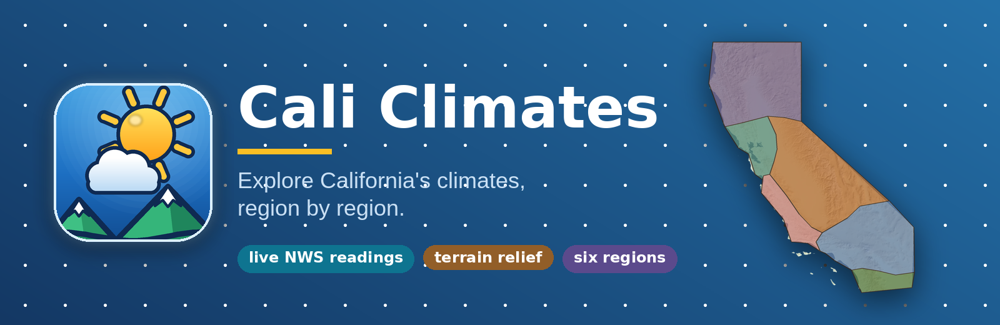
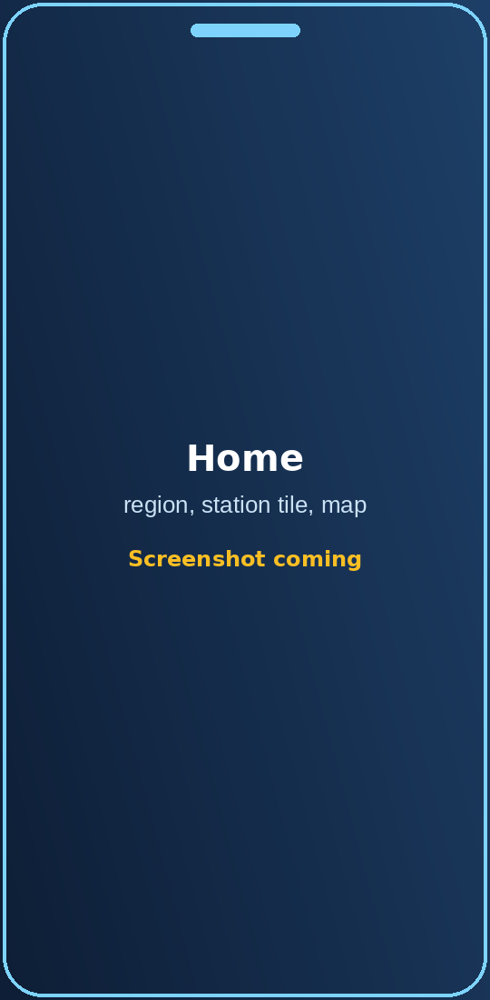
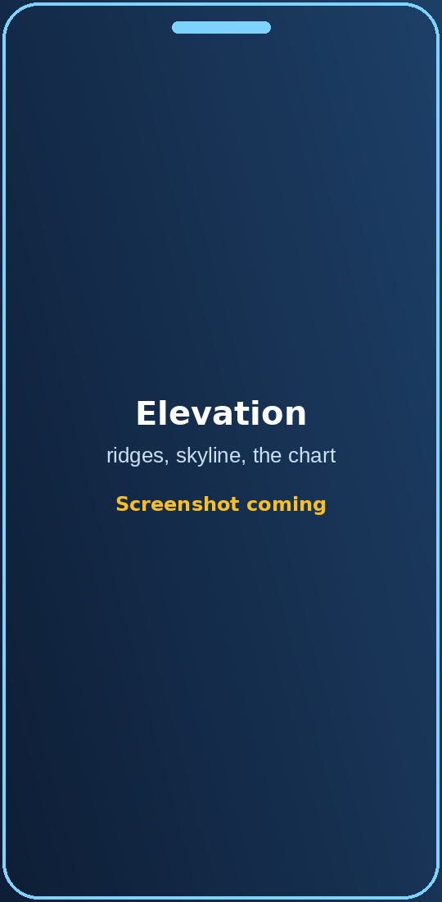
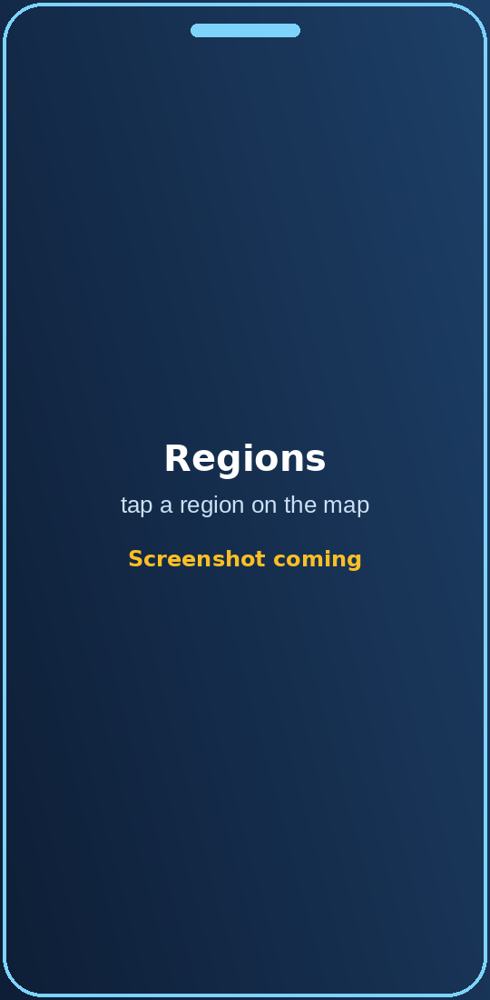
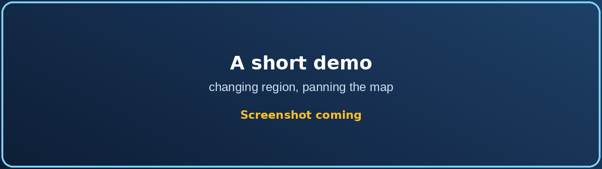
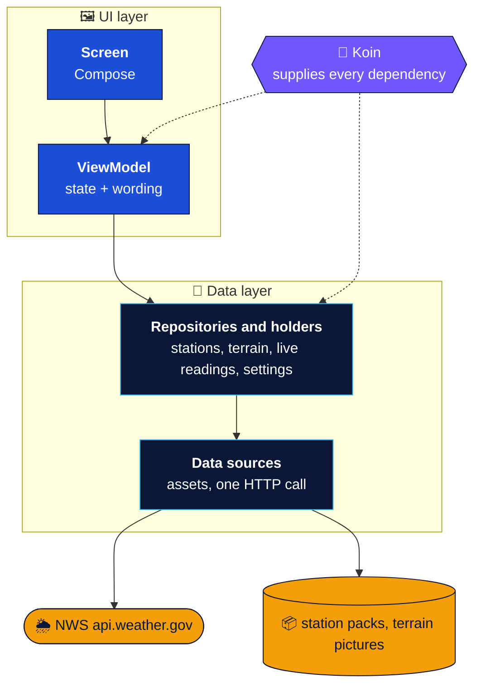
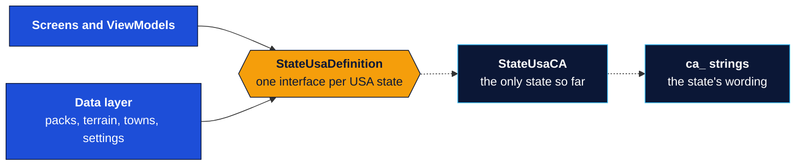
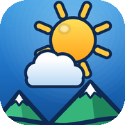

<div align="center">



<p>
<a href="#chip-nws"></a>
<a href="#chip-terrain"></a>
<a href="#chip-distance"></a>
<br>
<a href="#chip-bands"></a>
<a href="#chip-transitions"></a>
<a href="#chip-state"></a>
</p>

<br>

**An Android app that shows how California's weather changes from the coast to the mountains to the desert.**<br>
Live National Weather Service readings from 342 stations in six regions, on shaded-relief maps and an elevation chart.

<br>

<a id="screens"></a>

<div align="center">

<table>
  <tr>
    <td align="center"><br><sub><b>Home</b><br>region, station tile, map</sub></td>
    <td align="center"><br><sub><b>Profile</b><br>ridges and the profile</sub></td>
    <td align="center"><br><sub><b>Regions</b><br>tap a region on the map</sub></td>
  </tr>
</table>

<br>



</div>

<sub>Screenshots and a demo GIF are on the way. The images above are placeholders (see [`docs/images`](docs/images/README.md)).</sub>

<br>


[](LICENSE)

[**Screens**](#screens) &nbsp;·&nbsp; [**What it does**](#-what-cali-climates-does) &nbsp;·&nbsp; [**Design choices**](#-design-choices) &nbsp;·&nbsp; [**Run it**](#-run-it) &nbsp;·&nbsp; [**Architecture**](#-architecture) &nbsp;·&nbsp; [**Tech stack**](#-tech-stack) &nbsp;·&nbsp; [**Docs**](#-docs) &nbsp;·&nbsp; [**Status**](#-status)


</div>

## ✨ What Cali Climates does

California is many climates at once: fog on the coast, snow in the Sierra, desert heat an hour's drive inland. Cali Climates
shows that as it is right now. Pick one of six regions and see its weather stations on a relief map, with a real reading from
each, and how the numbers change as the ground climbs.

<table>
  <tr>
    <td width="33%" valign="top">
      <h4>🌡️ Live readings</h4>
      Temperature, humidity, wind and pressure from 342 National Weather Service stations, fetched on demand and kept for a few minutes so the app stays quick and polite.
    </td>
    <td width="33%" valign="top">
      <h4>🗺️ Six regions</h4>
      From Northern California to San Diego, each with its own earth tone. Change region and the page color, the map and the relief behind it all move together.
    </td>
    <td width="33%" valign="top">
      <h4>⛰️ Map view</h4>
      Stations on a shaded-relief picture of the region, with pinch, drag and double-tap zoom, and labels that appear as you zoom in.
    </td>
  </tr>
  <tr>
    <td valign="top">
      <h4>📈 Profile view</h4>
      The same stations as a profile from valley floor to ridge, with layered distant ranges drawn from the real skyline, so you can see why the temperature changes. Switch on <b>Elevation Bands</b> and the stations separate into three layers, north at the back, with distance from the selected station on every label. A quarter dial turns the view from north toward west, and the scenery pans as you turn: the sea and a few sailboats slide in at the horizon beside a wandering shore.
    </td>
    <td valign="top">
      <h4>🪪 Station cards and lists</h4>
      A card per station with its terrain, height in feet, a plain-words band ("foothills", "high country") and a comparison with a well-known landmark.
    </td>
    <td valign="top">
      <h4>📳 A tactile region change</h4>
      A soft haptic tick, the page easing to the new region's color and the relief sliding to another part of the landscape: switching feels physical, not like a screen swap.
    </td>
  </tr>
</table>

> [!NOTE]
> Readings come from the National Weather Service's public API (`api.weather.gov`), which needs no key. A station that cannot
> report shows plainly that it has no reading, instead of a made-up number.

## 🧭 Design choices

The six things on the banner are decisions about how the app should feel, made first and then built inside the usual Android
constructs (Jetpack Compose, MVVM, Retrofit). Each row says what the choice is and where it lives.

<a id="chip-nws"></a>
<br><br><br>

<table width="100%">
  <thead>
    <tr>
      <th width="30%" align="left">Design choice</th>
      <th align="left">Details</th>
    </tr>
  </thead>
  <tr>
    <td width="30%" valign="top"></td>
    <td valign="top">Every temperature, humidity, wind and pressure value comes from the National Weather Service's public API: no key, no made-up numbers. A reading is reused for 15 minutes, a station that failed is tried again after 5, and only four requests run at once, so the app stays quick and polite. A station with no reading says so.<br><sub>Code: <a href="app/src/main/java/io/github/genesjc/climatefinder/data/remote/NwsApi.kt"><code>NwsApi.kt</code></a>, <a href="app/src/main/java/io/github/genesjc/climatefinder/data/remote/NwsObservationClient.kt"><code>NwsObservationClient.kt</code></a>, <a href="app/src/main/java/io/github/genesjc/climatefinder/data/remote/LiveReadingsRepository.kt"><code>LiveReadingsRepository.kt</code></a></sub></td>
  </tr>
</table>

<a id="chip-terrain"></a>
<br><br><br>

<table width="100%">
  <thead>
    <tr>
      <th width="30%" align="left">Design choice</th>
      <th align="left">Details</th>
    </tr>
  </thead>
  <tr>
    <td width="30%" valign="top"></td>
    <td valign="top">Each region has a shaded-relief picture built from public elevation data (USGS 3DEP and NASA SRTM, through AWS Terrain Tiles). It is the ground under the Map view and the relief behind the Profile ridges. The pictures are made with scripts outside the app, so the app only loads them, off the main thread.<br><sub>Code: <a href="app/src/main/java/io/github/genesjc/climatefinder/data/local/TerrainRepository.kt"><code>TerrainRepository.kt</code></a>, <a href="app/src/main/java/io/github/genesjc/climatefinder/data/local/TerrainAssetPaths.kt"><code>TerrainAssetPaths.kt</code></a>, <a href="app/src/main/java/io/github/genesjc/climatefinder/ui/theme/AppBackground.kt"><code>AppBackground.kt</code></a></sub></td>
  </tr>
</table>

<a id="chip-distance"></a>
<br><br><br>

<table width="100%">
  <thead>
    <tr>
      <th width="30%" align="left">Design choice</th>
      <th align="left">Details</th>
    </tr>
  </thead>
  <tr>
    <td width="30%" valign="top"></td>
    <td valign="top">In the Profile view the labels around the selected station say how far each one is ("Name · 57 mi"). Near stations get larger, more solid labels and dots; far ones shrink and fade, but never below a readable size. The distances are great-circle miles, and the size, fade and dot factors are plain functions.<br><sub>Code: <a href="app/src/main/java/io/github/genesjc/climatefinder/domain/StationDistance.kt"><code>StationDistance.kt</code></a>, <a href="app/src/main/java/io/github/genesjc/climatefinder/domain/DepthCue.kt"><code>DepthCue.kt</code></a>, <a href="app/src/main/java/io/github/genesjc/climatefinder/ui/screens/ElevationLabels.kt"><code>ElevationLabels.kt</code></a></sub></td>
  </tr>
</table>

<a id="chip-bands"></a>
<br><br><br>

<table width="100%">
  <thead>
    <tr>
      <th width="30%" align="left">Design choice</th>
      <th align="left">Details</th>
    </tr>
  </thead>
  <tr>
    <td width="30%" valign="top"></td>
    <td valign="top">Switch it on and the Elevation chart splits the stations into three bands, each drawn as its own ridge: by latitude looking north (south in front), by longitude looking west (east in front), or at any angle between. A quarter-ring dial in the corner turns the view, snapping to north, northwest and west with a click, while a small heading-up compass at the top and a reading in the key (NW 56°) show the way it looks; the stations regroup as it moves, the band names and colours blend between the two ends, the lines tilt a little, and the scenery pans as one picture: green and golden hills looking north, a shore with sand, trees and hills sloping into the sea looking northwest, open sea with boats looking west. The bands keep a clear margin between them, the farther ones higher. The band holding the selected station stays sharp, with a ripple when it changes, and the key jumps between bands.<br><sub>Code: <a href="app/src/main/java/io/github/genesjc/climatefinder/domain/DepthBands.kt"><code>DepthBands.kt</code></a>, <a href="app/src/main/java/io/github/genesjc/climatefinder/ui/map/ElevationViewModel.kt"><code>ElevationViewModel.kt</code></a>, <a href="app/src/main/java/io/github/genesjc/climatefinder/ui/screens/ElevationProfileCanvas.kt"><code>ElevationProfileCanvas.kt</code></a>, <a href="app/src/main/java/io/github/genesjc/climatefinder/ui/components/LayerLegend.kt"><code>LayerLegend.kt</code></a>, <a href="app/src/main/java/io/github/genesjc/climatefinder/ui/components/BandAngleArc.kt"><code>BandAngleArc.kt</code></a>, <a href="app/src/main/java/io/github/genesjc/climatefinder/ui/components/BandCompass.kt"><code>BandCompass.kt</code></a></sub></td>
  </tr>
</table>

<a id="chip-transitions"></a>
<br><br><br>

<table width="100%">
  <thead>
    <tr>
      <th width="30%" align="left">Design choice</th>
      <th align="left">Details</th>
    </tr>
  </thead>
  <tr>
    <td width="30%" valign="top"></td>
    <td valign="top">Things move to where you are going instead of jumping. Labels fade in and out as you zoom, the map or chart eases over to a station you pick, and a region change eases the page colour and relief texture over 1.5 seconds with a soft haptic tick. The region picker grows out of its button and folds back into it.<br><sub>Code: <a href="app/src/main/java/io/github/genesjc/climatefinder/ui/components/MapZoom.kt"><code>MapZoom.kt</code></a>, <a href="app/src/main/java/io/github/genesjc/climatefinder/ui/theme/AppBackground.kt"><code>AppBackground.kt</code></a>, <a href="app/src/main/java/io/github/genesjc/climatefinder/ui/components/RegionHaptics.kt"><code>RegionHaptics.kt</code></a>, <a href="app/src/main/java/io/github/genesjc/climatefinder/ui/components/RegionPicker.kt"><code>RegionPicker.kt</code></a></sub></td>
  </tr>
</table>

<a id="chip-state"></a>
<br><br><br>

<table width="100%">
  <thead>
    <tr>
      <th width="30%" align="left">Design choice</th>
      <th align="left">Details</th>
    </tr>
  </thead>
  <tr>
    <td width="30%" valign="top"></td>
    <td valign="top">Map and Profile are two views of one set of choices. The selected station, the zoom, the dot size, the text size and whether the zoom slider shows are held once, in the Home view model, and handed to both views, so switching views never loses your place.<br><sub>Code: <a href="app/src/main/java/io/github/genesjc/climatefinder/ui/home/HomeViewModel.kt"><code>HomeViewModel.kt</code></a></sub></td>
  </tr>
</table>


## 🚀 Run it

**You need** Android Studio (current stable). The app runs on Android 7.0 (API 24) and newer.

```bash
git clone https://github.com/GeneSJC/CaliClimates_Kotlin.git
cd CaliClimates_Kotlin
```

1. Open the folder in Android Studio and let Gradle sync.
2. In the **Build Variants** panel keep the default, `coreFossDebug` (the app on its own, the open-source build).
3. Run it on a device or an emulator. The readings need an internet connection.

<details>
<summary><b>Command line and tests</b></summary>

```bash
# a debug APK of the default variant
./gradlew assembleCoreFossDebug

# unit tests (name both distributions: the bare task name is ambiguous with two flavor dimensions)
./gradlew testCoreFossDebugUnitTest testCoreCommercialDebugUnitTest
```

About 200 unit tests in 28 classes cover the ViewModels, the repositories, the live-readings holder, the NWS client (against a
local test server) and the station-file format. Two of them are rules written as tests: no user-facing word may be written
in code (every word is a string resource), and every USA state definition must satisfy the same checks.

</details>

## 🧱 Architecture

One direction only, with every layer doing one job:



| Layer | Owns | Must not |
|---|---|---|
| **Screen** | Layout, and local UI state such as animations and open dialogs | Hold data, or call a repository |
| **ViewModel** | The state a screen shows, the wording, one-off events | Contain a feature's data logic, or know about files and the network |
| **Repositories and holders** | One kind of data each: stations (read once and kept), terrain pictures, live readings (one app-wide holder), the saved settings | Know about screens or wording |
| **Data sources** | One external thing: the station files, the terrain pictures, the NWS call | Decide what the app does with the data |

**One idea is not obvious: a USA state is one object.** Everything that differs from one state to the next (its regions,
outline, terrain bounds, station files, station towns, landmarks, map artwork and wording) sits behind one interface, so the
rest of the app never names California:



That is why the code's package is `io.github.genesjc.climatefinder` and not the app's name: Cali Climates is the California edition of a state-neutral code base, and another state is an addition, not a rewrite.

### Principles at a glance

- 🧱 **Dependencies point one way.** Screens never reach a repository; the data layer never knows about screens.
- 💉 **Koin builds everything in one place** (`di/AppModule.kt`). ViewModels declare what they need as plain members and keep a no-argument constructor.
- 🔤 **Every user-facing word is a string resource,** kept in files by category. The data layers report facts (numbers, enums, resource ids); the screens and ViewModels choose the words. A test fails if a literal sneaks in.
- 🧪 **Everything is testable without a device.** Data sources sit behind small interfaces; tests register fakes with `restartKoin { single { fake } }`.
- 🌎 **One state, one interface.** A second USA state is a new definition object and its own strings, not a rework.
- 🅿️ **Parked work stays recoverable.** A feature that is not shipping is removed from the main line, tagged, and given a restore guide (see [Parked features](#parked-features)).

### Two editions, two distributions

| Dimension | Flavors | Meaning |
|---|---|---|
| `edition` | `core` (default), `demo` | **core** is the app alone. **demo** adds a *Demos & Previews* hub with legacy and prototype screens behind it. The demo edition is held back and does not build at the moment. |
| `distribution` | `foss` (default), `commercial` | Who publishes the build. `foss` is `io.github.genesjc.climatefinder` (version suffix `-foss`); `commercial` is `io.github.genesjc.climatefinder.commercial` (suffix `-commercial`). The ids differ, so both install side by side. |

Run the default variant, `coreFossDebug`, for a clean app. Edition-specific code lives in `app/src/core` and `app/src/demo`,
distribution-specific code in `app/src/foss` and `app/src/commercial`; `app/src/main` is shared. Neither distribution
contains any advertising code or library today.

### Where things live

```text
app/src/main/java/io/github/genesjc/climatefinder/
├── config/       the USA state definition (regions, geography, artwork, wording as resource ids), the build config
├── data/         repositories, the live-readings repository and its cache, the NWS client, saved settings
├── di/           AppModule: the one place Koin is told how things are built
├── domain/       the plain model, with no Android: stations, readings, elevation facts, the bands' maths
└── ui/
    ├── common/       the base ViewModel and the string resolver
    ├── components/   cards, the region picker, the Region Info sheet, map controls
    ├── home/ map/ regionpicker/ root/ stationlist/   the ViewModels
    ├── navigation/   which screen is showing (a ViewModel) and the navigation host
    ├── screens/      Home, the maps, the Profile view, the Station List, the region screen
    ├── text/         the helpers that turn facts into words, and the resource ids for domain values
    └── theme/        colors, the backdrop, and the USA state handed to the screens

app/src/main/assets/   the station packs and the terrain pictures
app/src/main/res/values/   strings by category (strings_region_ca.xml is California's)
app/src/core/  demo/  foss/  commercial/   per-flavor code      docs/   restore guides and README art
```

## 🧰 Tech stack

| | |
|---|---|
| **Language** | Kotlin 2.2 |
| **UI** | Jetpack Compose (BOM 2026.02), Material 3, custom Canvas drawing for the maps and the elevation chart |
| **Architecture** | MVVM with repositories and a state holder for live readings; Koin 4.2 for dependency injection |
| **Networking** | Retrofit 3.0 over OkHttp 4.12, kotlinx.serialization |
| **Async** | Kotlin Coroutines and Flow (StateFlow for state, a Channel for one-off events) |
| **Build** | Android Gradle Plugin 9.4, two flavor dimensions, minSdk 24, targetSdk 37 |
| **Tests** | JUnit 4, coroutines-test, MockK and MockWebServer where an Android class or the network is involved; fakes elsewhere |

## 📚 Docs

| Read | To learn |
|---|---|
| [`docs/ads-restore.md`](docs/ads-restore.md) | How to bring the parked ads work back, step by step |
| [`docs/news-restore.md`](docs/news-restore.md) | What the parked local-news feature was and how to bring it back |
| [`tools/angle-controls/`](tools/angle-controls/README.md) | Two earlier controls for the viewing angle, a slider and a heading strip, kept outside the build for comparing |
| [`docs/images/README.md`](docs/images/README.md) | The README artwork: what each image is and how to regenerate it |

## 📊 Status

| | |
|---|---|
| ✅ **Done** | Layered MVVM with Koin, string resources for every word, a USA state definition, live readings in one app-wide holder, Retrofit for the weather call, one settings store, a region change that never blocks the main thread, and a Profile view with distance cues and Elevation Bands (stations in three layers, by latitude, by longitude or at any angle between, turned with a dial) |
| ⏸️ **Parked** | Ads (AdMob banner and a one-hour ad-free reward) and a local-news block, each kept recoverable by a tag and a restore guide |
| 🔜 **Next** | A first release (store listing, privacy policy, signing), real screenshots for this page, and continuous integration |
| 💡 **Later** | A second USA state, localized place names, search on the Station List, and a cross-section chart (distance along a line) for the Profile view |

<a id="parked-features"></a>

## 📦 Parked features

Two features were built or started and then taken out of the main line so the code base only holds what ships. Each is
kept by an annotated git tag, and has a restore guide in this repository (Markdown, in `docs/`) that says what is in the
tag, what is missing, and how to bring it back onto a fresh branch from `develop`. Do not merge a tag: copy files from it.

| Feature | Tag | Restore guide | State |
|---|---|---|---|
| **Ads** (AdMob banner, consent, an ad-free hour for a rewarded video) | `ads-parked-2026-10-27` | [docs/ads-restore.md](docs/ads-restore.md) | Not on `develop`. The app is not published with ads for now, so the `commercial` build is ads-free: no ads code, library or manifest entry. The tag holds an SDK-free seam, the Gradle `adsEnabled` switch, tests, the foss-clean script and a copy of the ads kit. Written, never built; the real AdMob controller was not written. |
| **Local news** (a news block and story dialog on the station card) | `news-parked-2026-10-27` | [docs/news-restore.md](docs/news-restore.md) | Removed at Build 98.1. It was never shown to users (sample stories, behind a switch that was off). The tag is `develop` at Build 96.1, the last commit that had it, and it worked. |

Read a file from a tag without checking it out: `git show <tag>:<path>`. The station-to-town naming that used to live
beside the news code stays in the app, in `StationNameFormatter`.

## 📄 License

Apache License 2.0; see [`LICENSE`](LICENSE).

Weather readings come from the U.S. National Weather Service (`api.weather.gov`). The terrain pictures are built from public
elevation data (USGS 3DEP and NASA SRTM, through AWS Terrain Tiles). Cali Climates is an independent project and is not
affiliated with or endorsed by the National Weather Service, USGS or NASA.
The expand and collapse icons on the Elevation Bands button are from Google's Material Icons (Apache License 2.0).

<div align="center">


<br>



<sub>Built with Kotlin, Compose, a lot of small commits, and an interest in microclimates.</sub>

</div>
